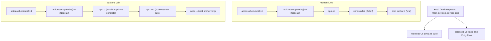

# CareDesk-AI

CareDesk-AI is an intelligent clinic and appointment management system featuring automated WhatsApp integration, AI-assisted scheduling, and a modern web dashboard.

---

## DevOps Continuous Integration (CI) Pipeline

### Purpose of the CI Pipeline

The CareDesk-AI CI pipeline is configured using GitHub Actions (`.github/workflows/ci.yml`) to enforce code quality, verify production builds, and run automated backend tests on every pull request and push to key development branches (`main`, `develop`, `devops-cicd`).

Automating these checks ensures that:
- Code syntax and contracts are verified continuously.
- Backend endpoint validations and business rules remain intact across refactors.
- Uncaught exceptions, malformed request handling, and authentication requirements are tested before deployment.
- Broken dependencies or regressions immediately fail the pipeline, preventing bad code from being merged.

---

## Backend Automated Testing Architecture

### Testing Framework Selected

- **Test Runner**: Node.js built-in test runner (`node:test`)
- **Assertions**: Node.js strict assertion library (`node:assert/strict`)
- **HTTP Endpoint Testing**: `supertest` (development dependency for exercising Express routes without opening external network ports)

**Rationale**:
- Built into Node.js 22 LTS with zero configuration overhead and native ESM/CommonJS support.
- Extremely fast execution with minimal dependency bloat.
- TAP-compliant output compatible with modern CI reporters.
- `supertest` provides robust HTTP request/response assertions directly against the exported Express application.

### Application Architecture Separation

To support deterministic automated testing without binding to network ports:
- **`server/src/app.js`**: Creates and configures Express, CORS policies, JSON verification middleware, cookie parsing, route mounts, health check endpoints, and centralized error handling. Exports the configured Express app without calling `listen()`.
- **`server/src/server.js`**: Imports `app` from `./app`, sets the port, and starts listening on the configured port. Preserves full production and development startup behavior.

---

## Test Categories & Coverage

The test suite covers 71 comprehensive automated tests across the following categories:

| Test Suite | File | Category / What It Verifies |
| :--- | :--- | :--- |
| **Health Check** | `server/tests/health.test.js` | Verifies `GET /api/health` and `/health` return HTTP 200 with `{ status: "ok", uptime, timestamp }`, content-type `application/json`, without leaking credentials or internal paths. |
| **Successful API Responses** | `server/tests/api.test.js` | Verifies `POST /api/auth/logout` clears the authentication cookie and `GET /api/whatsapp/webhook` handles Meta verification handshakes. |
| **Input Validation** | `server/tests/api.test.js` | Verifies client errors (HTTP 400) when required signup fields are missing, passwords are under 8 characters, login credentials are absent, or webhook retry payloads lack `messageId`. |
| **Authentication & Authorization** | `server/tests/api.test.js` | Verifies protected routes (`/api/auth/me`, `/api/patients`, `/api/doctors`, `/api/dashboard`, `/api/appointments`) reject unauthenticated requests with HTTP 401, reject malformed JWTs, and accept valid tokens signed by `JWT_SECRET`. |
| **Error Handling & CORS** | `server/tests/api.test.js` | Verifies malformed JSON bodies return HTTP 400 without crashing, unknown routes return HTTP 404, unauthorized origins are rejected by CORS, and allowed client origins receive proper CORS headers. |
| **WhatsApp AI & Security** | `server/tests/whatsappSecurity.test.js` | Verifies Meta X-Hub-Signature-256 HMAC SHA-256 signature verification and payload tampering detection. |
| **Appointment Confirmation** | `server/tests/appointmentConfirmation.test.js` | Unit and mock-db verification of slot availability revalidation, state transition idempotency, TTL expiration, and replay prevention. |
| **WhatsApp Flow Integration** | `server/tests/whatsappBookingFlow.test.js`, `server/tests/whatsappConfirmationFlow.test.js`, `server/tests/whatsappRescheduleFlow.test.js`, `server/tests/whatsappOutboundDelivery.test.js` | Verifies sequential webhook queuing, message deduplication, outbound retry logic, and concurrent turn serialization. |

---

## Local Verification Commands

### 1. Prerequisites

- **Node.js**: Version 22 LTS or higher
- **npm**: Version 10 or higher

### 2. Dependency Installation

Install dependencies using clean, deterministic lockfile installations:

```bash
# Frontend
cd client
npm ci

# Backend
cd ../server
npm ci
```

> **Note**: The backend `npm ci` command automatically executes `postinstall` (`prisma generate`), ensuring the local Prisma Client is generated and up to date.

### 3. Running Backend Tests Locally

From the `server` directory:

```bash
# Run all automated tests
npm test

# Run a specific test suite
node --test tests/health.test.js
node --test tests/api.test.js
```

### 4. Running Backend Entry Point Verification

```bash
# From server directory
node --check src/server.js
node --check src/app.js
```

### 5. Running Frontend Quality Checks

From the `client` directory:

```bash
npm run lint
npm run build
```

---

## GitHub Actions CI Workflow

The workflow (`.github/workflows/ci.yml`) runs two parallel, independent jobs:



### Interpreting Workflow Failures

- **Frontend Lint Failure**: Oxlint detected an error (e.g. invalid syntax or broken imports).
- **Frontend Build Failure**: Vite bundle failed due to TypeScript/JSX syntax errors or missing assets.
- **Backend Test Failure (`npm test`)**: A backend assertion failed (e.g., status code changed, validation rule altered, or authentication bypass).
- **Backend Entry Point Failure (`node --check src/server.js`)**: JavaScript syntax error in `server.js` or an invalid import.

---

## Security Considerations & Best Practices

1. **No Credentials in Tests**: Tests run with dummy fixture secrets (`JWT_SECRET`, `WHATSAPP_VERIFY_TOKEN`) and never touch production credentials or external services.
2. **Database Isolation**: Unit and HTTP tests use in-memory state, mock adapters, or isolated test fixtures. No production database mutations occur during CI.
3. **No Secret Leaks**: Health and error endpoints explicitly filter out stack traces, environment variables, and connection strings.
